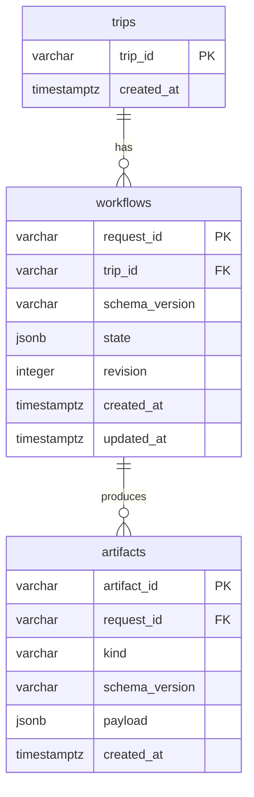

# Thiết kế lưu trữ Backend (Task 1–6)

Nguồn: [Cấu trúc schema.md](<Cấu trúc schema.md>), đặc biệt mục 2–10. Architecture.md mô tả Frontend; không thay đổi cấu trúc đó. Đây là đề xuất lưu trữ kỹ thuật, không bổ sung quy tắc nghiệp vụ. Chưa có Orchestrator, Agent, Planner hoặc Validator thật.

## Trách nhiệm và vòng đời

| Nhóm | Lưu trữ | Trách nhiệm |
|---|---|---|
| Dữ liệu lâu dài | trips; artifacts loại trip_request, itinerary, validation_result | Định danh chuyến đi, yêu cầu và các phiên bản kết quả có thể truy vết |
| Trạng thái workflow | workflows.state | Toàn bộ WorkflowState: status, current_step, completed_steps, artifacts, pending_fields/questions, answers_history, clarification_round/max_clarification_rounds, attempts, retry_count, errors |
| Artifact trung gian | artifacts.payload JSONB | DestinationResult, TimeConstraints, danh sách PlaceCandidate, BudgetResult, PlanningInput; giữ nguyên trường, nguồn, confidence, giá null và ma trận |
| Tạm thời trong bộ nhớ | Không lưu bảng | HTTP clients, DB sessions, prompt đang dựng, response chưa validation, bộ nhớ solver ở giai đoạn sau |

Một trip có thể có nhiều yêu cầu lập lại; một request có nhiều artifact bất biến. ID là chuỗi do bên gọi cung cấp, không áp đặt UUID lên ví dụ req_001/trip_001. Index FK hỗ trợ truy vấn lịch sử. Không cascade delete lịch sử. Chưa tạo users, catalog places hay bảng cho mỗi model vì tài liệu chưa định nghĩa authentication, quyền sở hữu hay catalog dùng chung.

Artifact đã lưu không UPDATE/DELETE được (trigger PostgreSQL). Tạo ID mới cho phiên bản mới; repository chỉ cung cấp add/get. Envelope payload dạng object: candidates có thể được lưu dưới wrapper versioned `{"schema_version":"1.0","places":[...]}` (wrapper lưu trữ đề xuất, không đổi output list của PlaceAgent); BudgetResult giữ envelope của mục 6. Retention và xóa dữ liệu cá nhân cần thiết kế riêng trước production, chưa có chức năng đó.

WorkflowState chứa bản tham chiếu artifact mới nhất, còn tất cả phiên bản nằm trong artifacts. Những ID nằm trong JSONB không có FK riêng. Future orchestrator/repository phải xác minh ID thuộc request, đúng kind/version và ghi artifact + checkpoint trong cùng transaction. Chưa tuyên bố có đảm bảo đó ở giai đoạn này. `revision` dùng optimistic concurrency của SQLAlchemy ORM; raw SQL không có cơ chế kiểm tra revision tự động. Tránh lưu status/current_step lần hai trong cột riêng để không có hai nguồn trạng thái. Chưa thêm index JSONB khi chưa có mẫu truy vấn.

Tiền nằm trong JSONB dưới dạng integer, không đổi sang float; timestamps của DB có timezone. Schema Pydantic kiểm tra cấu trúc trước khi lưu; DB không tự kiểm tra toàn bộ nội dung JSONB. Payload ORM phải được xem như read-only; repository không cung cấp sửa. Không lưu API key hoặc connection string trong artifact.

## Các điểm cần xác nhận từ tài liệu

| Điểm | Hiện trạng và xử lý trong skeleton |
|---|---|
| JSON/JSONC sai cú pháp | Trailing comma, smart quotes, thiếu dấu phẩy/ngoặc, `"max_candidates":100` nằm trong array, enum viết bằng dấu `/`, văn xuôi nằm trong code block. Đây là lỗi ví dụ; không suy ra thay đổi schema. Fixture TripRequest sửa cú pháp, giữ cấu trúc. |
| selection_status | Bảng đầu nói bốn giá trị nhưng dòng thứ tư là pending_fields của WorkflowState; bảng hỏi lại sau đó thêm needs_more_info. Contract giữ cả needs_more_info vì được nêu rõ ở bảng sau, không dùng pending_fields làm status. INSUFFICIENT là request_type. Cần chốt danh sách status chính thức. |
| Giới hạn hỏi điểm đến | Phần hỏi lại của Agent A dùng destination_round tối đa 2 và chọn ứng viên đầu làm mặc định; mục 9.2 dùng chung clarification_round tối đa 3 cho cả yêu cầu. WorkflowState theo mục 9.1, không tự thêm destination_round hoặc thực hiện default chọn ứng viên. Cần xác nhận trước Orchestrator. |
| Agent A/B input | Ví dụ B dùng selected_destination_id nhưng DestinationResult không định nghĩa trường này. Interface nhận nguyên DestinationResult, không tự thêm selected_destination_id. |
| TimeConstraints | Mục 3 có pace, transport_mode; ví dụ 7/8 bỏ một số trường. Giữ cấu trúc mục 3. start_location_id/end_location_id chỉ xuất hiện trong văn xuôi: giữ nullable, không tự tạo điểm thật. |
| Schema version | Mục 10 yêu cầu mọi hợp đồng có version nhưng nhiều ví dụ không có. Thêm schema_version mặc định 1.0 ở hợp đồng cấp bước, chấp nhận major 1, từ chối major khác; object lồng không có version riêng. |
| Budget C output | Tiêu đề CostedPlaceCandidate[] nhưng JSON là envelope places/missing_costs/budget_reason. Dùng BudgetResult cho envelope, places là list CostedPlaceCandidate. Builder nhận thêm PlaceCandidate gốc vì output C đã bỏ location/opening_hours/visit_duration. Không âm thầm mất dữ liệu. |
| admission_price_raw | Chỉ có tên trong bảng bổ sung, không có shape. Giữ optional dict opaque; cần xác nhận shape và đơn vị trước khi tích hợp nguồn giá. |
| score_budget | Chỉ xuất hiện trong văn xuôi mục 7.3, không có miền giá trị. Giữ optional float ở CostedPlaceCandidate, không đưa vào PlanningInput. |
| Giá và nguồn | Chỉ các nhãn ESTIMATED, UNKNOWN, VERIFIED_FREE được nêu rõ: chưa tự thêm nhãn giá trả tiền đã xác minh. Chưa có trường source/confidence thống nhất cho ước tính giá; cần chốt trước Agent thật. |
| Các enum chưa đầy đủ | scope, flexibility, pace, category, transport, interests, visit_duration.source, business_status, constraint.type không có danh sách đầy đủ. Giữ str thay vì tự bịa enum; các enum đã liệt kê dùng Literal giữ nguyên case. `whole_trip` dùng trong fixture; `whole trip` ở ví dụ 8 là mâu thuẫn, không tự normalize. |
| budget.excludes=[null] | Mục 7 có null trong list; mục 2 dùng list tên khoản. Hợp đồng dùng list[str], null trong list bị từ chối. Cần xác nhận ý nghĩa nếu null là chủ ý. |
| Budget preferences | Xuất hiện chỉ ở input C: giữ optional dict[str,str] trên Budget, chưa áp quy tắc HIGH/NORMAL. |
| Ma trận | 3 locations nhưng 6×6 values là lỗi dữ liệu minh họa, không phải cú pháp JSON. Model từ chối ma trận sai kích thước, không cắt hay bổ sung dữ liệu. |
| Chi phí di chuyển | Mục 7 tính cả chặng về và chi phí di chuyển; 8.5 nói không tính chi phí di chuyển, summary chỉ tính chặng giữa hoạt động. Không chọn âm thầm: chưa triển khai Engine/Validator; cần xác nhận trước triển khai. |
| Rule name | checked_rules ví dụ dùng day_window; bảng 8.4 dùng day_start_window; dòng 8 còn nhắc day_end_window không có trong TimeConstraints. checked_rules giữ list[str], chưa hardcode registry 14 rules. |
| Itinerary totals | Ví dụ 7.4 có chi phí và thời gian khác cách tính 8.5. Không dùng làm fixture hợp lệ cho Validator; Validator ngoài phạm vi. |
| Relaxation/finding | relaxation_suggestions không có schema phần tử; giữ dict opaque. Findings có type/rule/severity/message và các số đo nêu trong tài liệu; chưa xác nhận shape cho mọi type lỗi. |
| Attempt | Mục 10 yêu cầu time_limit_seconds nhưng ví dụ attempts thiếu: giữ trường bắt buộc cùng random_seed để tái lập. |
| Thiếu dữ liệu | Các trường được phép chưa biết giữ None; không đổi thành 0. missing_fields là dữ liệu của parser trong tương lai; skeleton không tự hỏi, áp default hoặc điều phối. |

## Ranh giới hợp đồng

`ai/agents/interfaces.py` định nghĩa async Protocol cho đủ 9 thành phần. Tất cả nhận/trả model; lỗi schema dùng Pydantic ValidationError, lỗi kỹ thuật dùng ApplicationError(code, message, retryable), kết quả nghiệp vụ được trả dưới dạng dữ liệu (missing_fields, infeasible, violations). WorkflowState thuộc Orchestrator tương lai, không truyền một đối tượng mutable để Agent tự sửa.

Parser nhận ngày hiện tại từ bên gọi để hiểu ngày tương đối. Defaults, max_candidates, exclude IDs và configuration là đầu vào tường minh; chưa tự quyết định giá trị nghiệp vụ. Builder nhận cả output B và C để nối theo place_id. Validator nhận Itinerary và PlanningInput, không đọc lại TripRequest, không gọi LLM. Explainer chỉ nhận kết quả đã được chấp nhận; đối chiếu văn bản và fallback là trách nhiệm implementation tương lai. Model validation hiện tại kiểm tra kiểu, date order, time format, tiền nguyên/range, matrix shape, soft target, extra fields và major version; không thay cho 14 quy tắc Validator.
